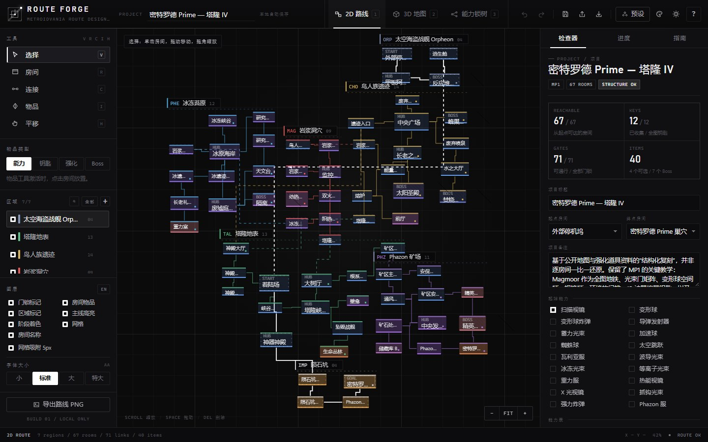
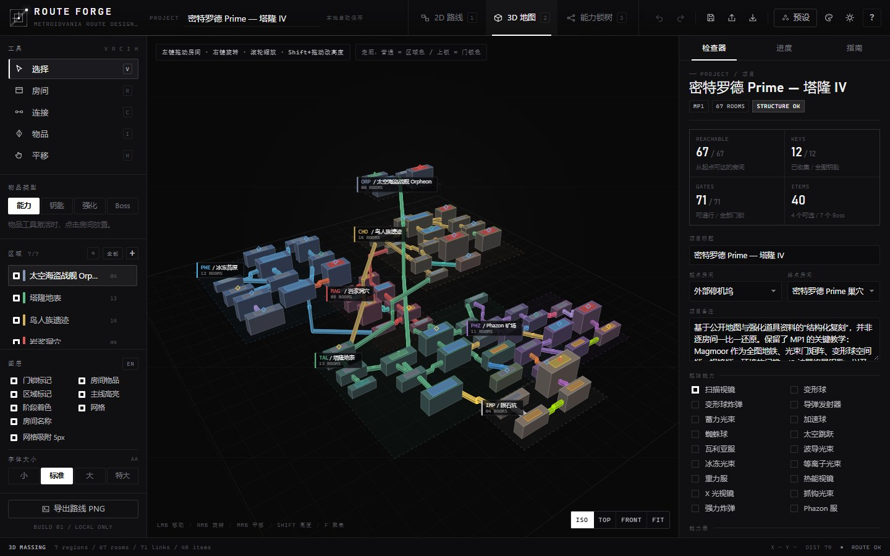
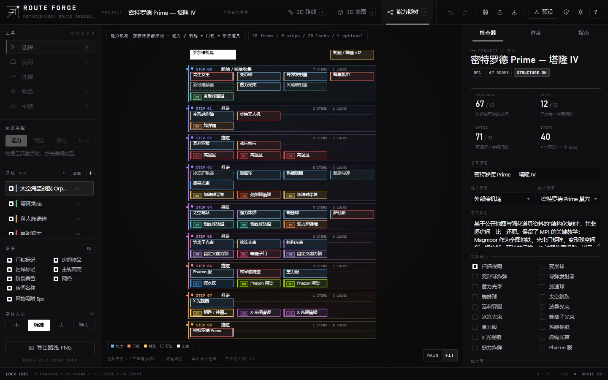
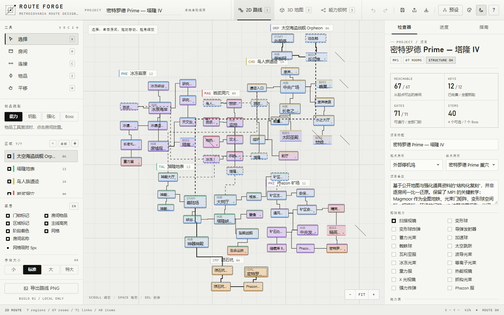
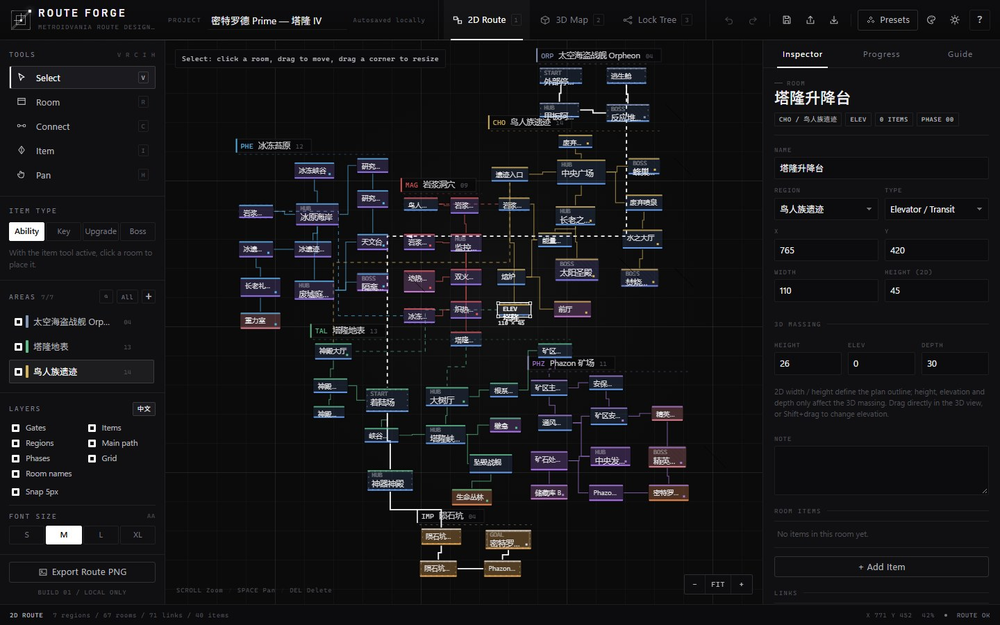

# Metroidvania Route Designer

[中文](README.md) | **English**

A level-route design tool for 3D Metroidvania games. It combines a **2D route graph**, **3D room massing** and an **ability lock tree** in one browser project for early structure design, lock-chain validation and spatial exploration.

Internal codename: **ROUTE FORGE**. Pure frontend, zero dependencies: open `index.html` and it runs.

[GitHub repository](https://github.com/ElecHex/Metroidvania-Route-Designer)



| 3D room massing | Ability lock tree |
| --- | --- |
|  |  |
| **Light theme** | **Color / monochrome** |
|  | Phase ramp, gate colors and region colors are customizable |

## Features

### 1. 2D Route Editor

- Drag to draw rooms, drag to move, drag a corner to resize
- Room types: normal, start, hub, boss, save, elevator, hazard, goal
- Region grouping and region colors
- Place abilities, keys / artifacts, optional upgrades, bosses / events inside rooms
- Connect two rooms and choose a gate:
  - Beam gates (Ice / Wave / Plasma), Missile Door
  - Morph Ball tunnel, Bomb Slot, Boost Ball half-pipe, Spider Ball track
  - Grapple Point, Power Bomb wall, Scan Terminal
  - Thermal / X-Ray Visor lock, heat / deep-water / Phazon hazard
  - Artifact / key seal, elevator, custom ability lock
- One-way links, direction swap, custom ability requirements and key counts
- Undo / redo, autosave, JSON import/export, route PNG export
- Quick jump to room (`/` or `Ctrl/Cmd + K`), arrow-key nudging, snap-grid toggle
- Copy / paste a room with its items (`Ctrl/Cmd + C / V`), duplicate in place with `Ctrl/Cmd + D`
- Orthogonal links and orthogonal region leaders (no 45° diagonals)

### 2. 3D Room Massing Map

- Seamless 2D / 3D switching with synchronized selection
- Rooms are real 3D blocks and remain editable:
  - Drag to change plan position
  - `Shift + drag` to change base elevation
  - Edit height / elevation / depth in the inspector
- Region base elevations let different regions float on separate floors
- **Links are modeled geometry, not lines**:
  - Same-floor links generate solid corridor prisms
  - Cross-floor links generate a horizontal run plus a vertical shaft (elevator)
  - Both ends get door frames / threshold blocks; the middle gets a gate barrier
- Type-specific room details: roof panels, boss pedestal, save / start / goal beacons
- Normal corridors use the target region color; locked corridors use the gate color; selecting a room highlights all its corridors
- Camera: left-drag rooms, right-drag orbit, middle-drag pan, wheel dolly, ISO / TOP / FRONT presets

### 3. Progression Analysis

Automatically simulates progression from the start room:

- Reachable rooms / total rooms
- Opened gate count and gate-type statistics
- Collected keys / artifacts and the global key budget
- Phase index for every room (first reachable step)
- Progression timeline: acquisition order of abilities, keys and bosses
- Shortest main path
- Region coverage
- Structural warnings:
  - Goal unreachable
  - Ability has no source
  - Ability items sit in unreachable rooms (potential deadlock)
  - Insufficient key budget
  - Unreachable rooms contain items

The progress panel is linked to **Phase Colors** and **Main Path** in 2D / 3D.

### 4. Region Visibility Filter

- Checkboxes in the left region list show / hide any region independently
- Show one, several or all regions at once
- The region inspector offers “Show Only This Region”
- “All” above the list restores every region
- FIT fits only the visible regions
- Filtering affects 2D / 3D rendering only; progression analysis still uses the full project

### 5. Ability Lock Tree / Unlock Timeline

Inspired by Boss Keys-style lock-and-key analysis, the third view arranges the route as a **vertical lock timeline ordered by acquisition step**:

- Each row is a progression step (`STEP 00` → endgame); top to bottom is unlock order
- Upper cards: abilities, keys, boss flags and optional upgrades acquired in this step
- Lower gate cards: gates unlocked in this step, directly labeled “← requires / → leads to”
- Top: start room and global key pool
- Main-path cards and gates are emphasized; `MAIN` dims everything outside the main path
- Linked to existing features:
  - Click a card: select the matching item or link in the inspector
  - Click a gate card: select that link
  - Double-click a card or press `F`: switch to 2D and locate it
  - Theme, color / monochrome, zoom, pan and FIT are supported
- Current MP1 preset output: **28 items / 9 steps / 20 locks**

### 6. Theme & Semantic Color

- Sun / moon button in the top bar switches **dark / light** theme
- The palette button opens color settings:
  - Color / monochrome switch
  - Five-segment phase ramp, editable segment by segment
  - A separate color for each region
  - Spectrum / Cool / Warm / Earth / Neon presets
  - Gate color legend
- Color semantics:
  - Room top edge: region color
  - Room bottom edge: phase color
  - Gate badges: gate color
  - Item glyphs: ability / key / upgrade / boss
  - 3D corridors: normal links use the target region color, locked links use the gate color
- Monochrome keeps the black-and-white blueprint look

### 7. Font Size

- Four font sizes at the bottom of the Layers panel: **S 100% / M 115% / L 130% / XL 145%**
- Default is **M 115%**, larger than the old 100%
- Scales both interface text and 2D / 3D / lock-tree Canvas labels
- The setting persists in localStorage across reloads

### 8. Chinese / English Interface

- The **EN / 中文** button next to the Layers heading switches the interface language
- Covers static chrome, inspector, progress panel, design guide, help, palette, presets, quick jump and lock-tree Canvas labels
- The language persists in localStorage across reloads
- Preset room / item / region names are **project data** and keep the language they were authored in



## Quick Start

No installation or build step:

```bash
git clone https://github.com/ElecHex/Metroidvania-Route-Designer.git
cd Metroidvania-Route-Designer
```

Open `index.html` directly in a browser.

You can also run a local static server:

```bash
python -m http.server 8000
# open http://127.0.0.1:8000/
```

The project uses only native HTML / CSS / JavaScript and Canvas, with no third-party runtime.

## Controls

| Action | Shortcut / Gesture |
| --- | --- |
| 2D / 3D / ability lock tree | `1` / `2` / `3` |
| Select / room / connect / item / pan | `V` / `R` / `C` / `I` / `H` |
| Quick jump to room | `/` or `Ctrl/Cmd + K` |
| Move selected room | `Arrow keys` (5 units) / `Shift + Arrow keys` (1 unit) |
| Copy / paste room | `Ctrl/Cmd + C` / `Ctrl/Cmd + V` (with items, without links) |
| Duplicate room in place | `D` or `Ctrl/Cmd + D` |
| 2D pan | Space + drag, or middle / right-drag |
| 2D zoom | Wheel / `FIT` at bottom right |
| 3D orbit / pan / dolly | Right-drag / middle-drag / wheel |
| 3D move room / change height | Left-drag / `Shift + left-drag` |
| Lock tree pan / zoom | Drag empty space / wheel |
| Lock tree locate | Double-click a node, or select and press `F` |
| Delete selection | `Delete` / `Backspace` |
| Undo / redo | `Ctrl/Cmd + Z` / `Ctrl/Cmd + Shift + Z` |
| Save | `Ctrl/Cmd + S` |
| Exit input / cancel connection / close modal | `Esc` |

## Built-in Presets

| Preset | Regions | Rooms | Links | Items | Notes |
| --- | ---: | ---: | ---: | ---: | --- |
| Metroid Prime — Tallon IV | 7 | 67 | 71 | 40 | 12 Artifacts, beam-gate matrix, Magmoor transit hub |
| Super Metroid — Zebes | 6 | 32 | 31 | 21 | Four bosses seal Tourian, abilities as keys |
| Hollow Knight — Hallownest | 9 | 26 | 25 | 24 | Ability unlocks, unique keys, three Dreamers seal |
| Blank Route | 1 | 1 | 0 | 0 | Custom starting point |

All presets pass the reachability self-check; the goal is reachable.

> **Note**: The Metroid Prime preset is a **structured reference** assembled from public maps / walkthroughs. It preserves region relationships, key abilities, gate types and the 12-artifact endgame, but is not a room-by-room 1:1 reproduction of the official map. Some room coordinates, save stations and item placements are simplified for design demonstration.

## Data & Persistence

Project structure:

```json
{
  "regions": [],
  "rooms": [],
  "links": [],
  "items": [],
  "abilities": [],
  "phaseColors": [],
  "startRoom": "",
  "goalRoom": ""
}
```

- Rooms contain 2D position / size, region, type and 3D height / elevation / depth
- Links contain `gate`, `requires[]`, `keyReq` and direction
- Items contain `kind`, room, granted ability, key count and optional flag
- The analyzer produces `roomPhase`, `openLinks`, `timeline`, `path`, `gateChains` and more

Persistence:

- Autosave to browser `localStorage`
- The top-bar save button writes immediately
- JSON export / import
- The previous project is backed up to `routeforge.backup.v1` before import
- Route PNG export re-lays out a high-resolution drawing independent of the current zoom

## Project Structure

```text
.
├── index.html              # App shell, modes, panels, Canvas
├── css/app.css             # Monochrome UI, light/dark, responsive
├── js/i18n.js              # Chinese / English interface language
├── js/core.js              # Data model, theme tokens, color tools, storage, history
├── js/presets.js           # Metroid Prime / Super Metroid / Hollow Knight / Blank
├── js/logic.js             # Reachability analysis, deadlock checks, timeline, gate chains
├── js/render2d.js          # 2D route canvas
├── js/render3d.js          # 3D massing, solid corridors, door frames, orbit camera
├── js/tree.js              # Ability lock tree layout and canvas
└── js/app.js               # UI events, inspector, progress, palette, modals, import/export
```

## Design Notes

The tool is not primarily about “drawing rooms.” It maintains three mutually consistent structures:

1. **Ability / key set**: what the player has acquired
2. **Gate requirements**: which abilities and how many keys each gate needs
3. **Spatial massing**: how those gates and rooms connect in 3D

The 2D view answers “in what order does the player acquire what,” the 3D view answers “how is space organized vertically,” and the lock tree answers “how do abilities unlock later content.” All three share the same project data and analysis result.

The ability lock tree is not a simple room thumbnail map: it organizes the route vertically by acquisition step and shows gates as separate cards with their requirements and target room, emphasizing “when, with which ability, which door opened” rather than drawing every room as a node.

## Known Limitations

- Presets are structured references, not official level data
- The tool targets desktop browsers; narrow windows work but require more panning / zooming
- Data lives in the current browser's `localStorage`; use JSON import/export across devices
- There is no game-engine export format yet; PNG / JSON are the primary outputs
- The 3D view is a design massing map, not a first-person playable level

## References

- [Metroid Recon — Metroid Prime Power-up locations](https://www.metroid.retropixel.net/games/mprime/items1.php)
- [StrategyWiki — Metroid Prime Locations](https://strategywiki.org/wiki/Metroid_Prime/Locations)
- [Metroid Wiki — X-Ray Visor / Life Grove](https://www.metroidwiki.org/wiki/X-Ray_Visor)
- [Nintendo Life — Metroid Prime Remastered Upgrade Locations](https://www.nintendolife.com/guides/metroid-prime-remastered-power-suit-upgrade-locations)
- [Super Metroid Map Archive](https://www.snesmaps.com/maps/SuperMetroid/SuperMetroidMap.html)
- [Hollow Knight Wiki](https://hollowknight.wiki/)

## Notice

This project is intended for learning, prototyping and structural analysis of Metroidvania level design. Metroid / Metroid Prime names and characters belong to Nintendo; Hollow Knight names belong to Team Cherry. The repository ships no official assets.
