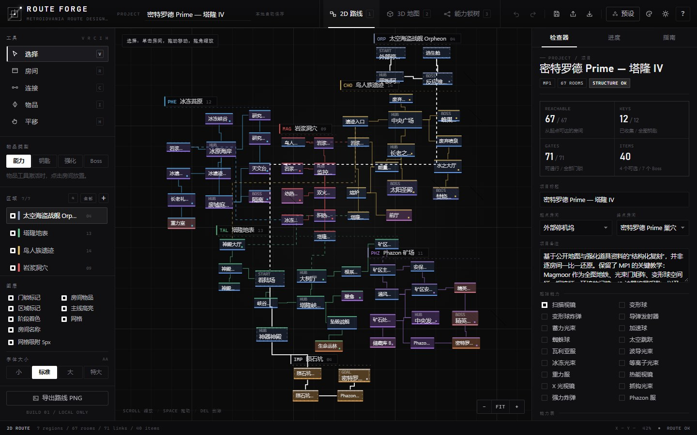
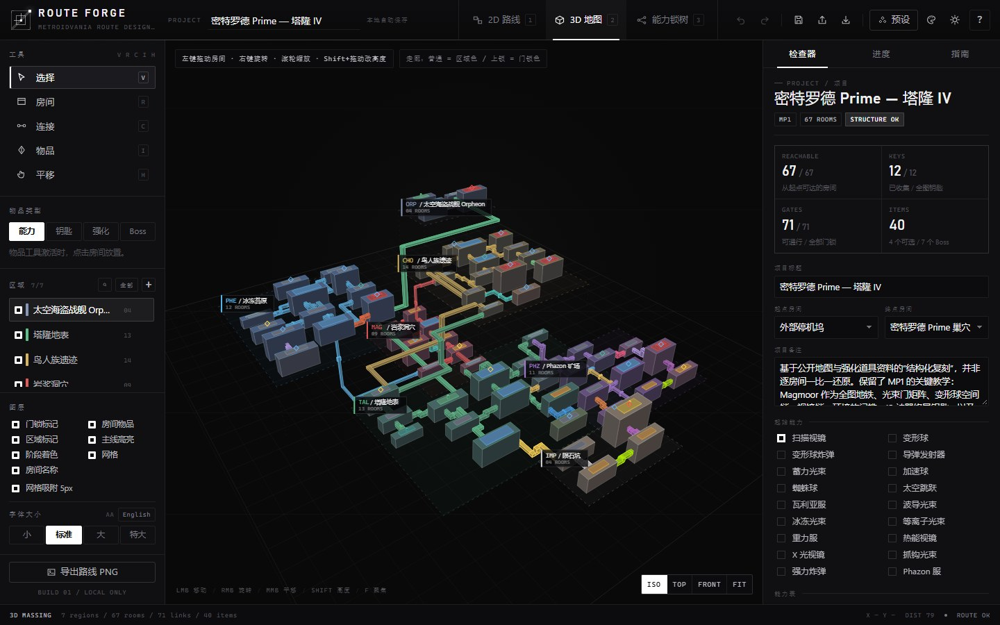
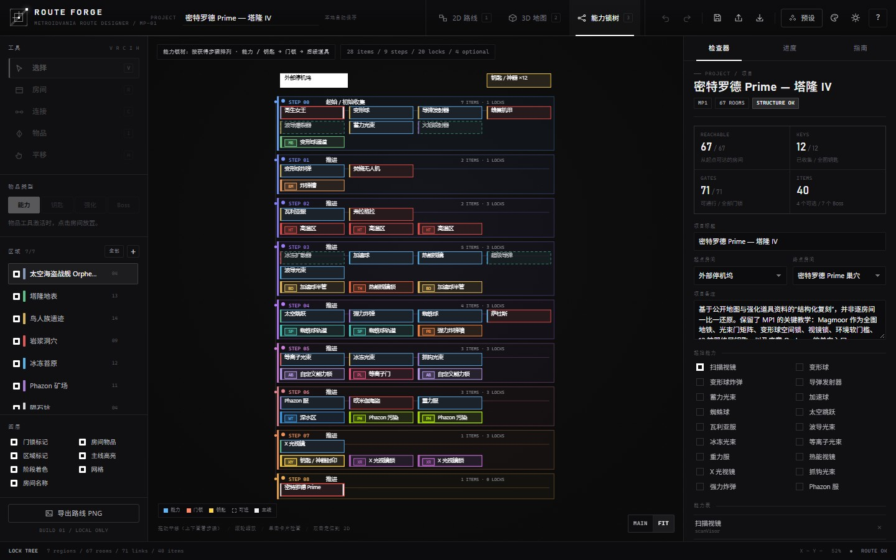
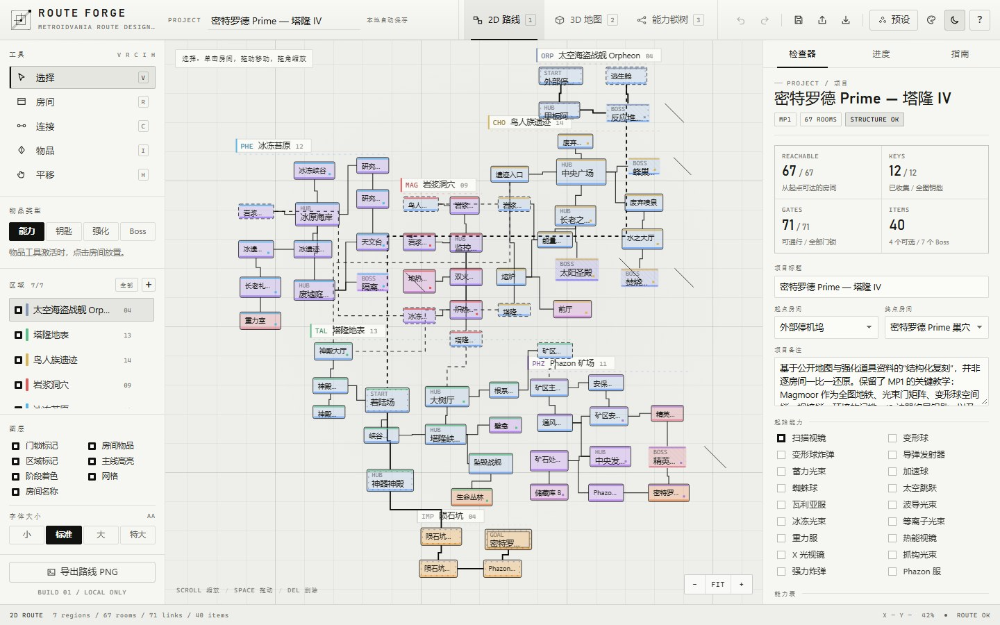

# Metroidvania Route Designer

面向 3D 银河城（Metroidvania）的关卡路线设计工具。把「2D 路线图」「3D 房间体块」「能力锁树」放在同一个浏览器项目里，用于前期结构设计、锁链验证和空间推演。

项目代号 **ROUTE FORGE**。纯前端、零依赖，直接打开 `index.html` 即可运行。

[GitHub 仓库](https://github.com/ElecHex/Metroidvania-Route-Designer)



| 3D 房间体块 | 能力锁树 |
| --- | --- |
|  |  |
| **白天主题** | **彩色 / 单色可切换** |
|  | 色板、门锁色、区域色与阶段色带均可自定义 |

## 功能

### 1. 2D 路线编辑器

- 拖拽绘制房间，拖动移动，拖角缩放
- 房间类型：普通、起点、枢纽、Boss、存档、升降机、环境危害、终点
- 区域分组与区域颜色
- 房间内放置能力、钥匙 / 神器、可选强化、Boss / 事件
- 连接两个房间并选择门锁：
  - 光束门（冰冻 / 波导 / 等离子）、导弹门
  - 变形球通道、炸弹槽、加速球半管、蜘蛛球轨道
  - 抓钩点、强力炸弹墙、扫描终端
  - 热能 / X 光视镜锁、高温 / 深水 / Phazon 环境锁
  - 神器 / 钥匙封印、升降机、自定义能力锁
- 单向连接、方向反转、自定义能力需求与钥匙数量
- 撤销 / 重做、自动保存、JSON 导入导出、路线 PNG 导出
- 正交连线与正交区域引线（无 45° 斜线）

### 2. 3D 房间体块地图

- 2D / 3D 无缝切换，选中状态同步
- 房间是真实 3D 体块，可编辑：
  - 拖动改变平面位置
  - `Shift + 拖动` 改变基座高度
  - 检查器编辑层高 / 基座 / 进深
- 区域基座高度让不同区域分层悬浮
- **连接是实体建模，不是线**：
  - 同层连接生成实体走廊棱柱
  - 跨层连接生成水平段 + 竖向井（升降机）
  - 两端有门框 / 门槛块，中段有门锁闸门
- 房间类型化细节：屋顶面板、Boss 台座、存档 / 起点 / 终点信标
- 普通通道使用目标区域色；上锁通道使用门锁色；选中房间时其全部走廊高亮
- 相机：左键操作房间、右键旋转、中键平移、滚轮缩放、ISO / TOP / FRONT 预设

### 3. 进度分析

从起点自动模拟推进：

- 可达房间 / 全图房间
- 门锁开启数量与类型统计
- 钥匙 / 神器收集数与全局预算
- 每个房间的阶段编号（首次可达步骤）
- 进度时间轴：能力、钥匙、Boss 的获得顺序
- 主线最短路径
- 区域覆盖率
- 结构警告：
  - 终点不可达
  - 能力没有来源
  - 能力道具位于不可达房间（潜在锁死）
  - 钥匙预算不足
  - 不可达房间包含道具

进度面板与 2D / 3D 的「阶段着色」「主线高亮」联动。

### 4. 区域显隐过滤

- 左侧区域列表的复选框可独立显示 / 隐藏任意区域
- 可同时显示一个、几个或全部区域
- 区域检查器提供「仅显示此区域」
- 标题栏「全部」恢复所有区域
- FIT 只适应可见区域
- 过滤只影响 2D / 3D 渲染，不影响完整项目的进度分析

### 5. 能力锁树 / 解锁时间线

受 Boss Keys 式锁钥分析启发，第三个视图把路线整理成**按获得步骤纵向排列的锁钥时间线**：

- 每一行是一个推进步骤（`STEP 00` → 终局），从上到下就是解锁顺序
- 上方卡片：本步获得的能力、钥匙、Boss 旗标、可选强化
- 下方门锁卡片：本步解锁的门，直接标注“← 需要什么 / → 通向哪里”
- 顶部：起始房间与全局钥匙池
- 主线卡片与门锁会加粗 / 标记；`MAIN` 按钮压暗非主线
- 与已有功能联动：
  - 单击卡片：在检查器中选中对应物品或连接
  - 单击门锁卡片：选中该连接
  - 双击卡片或按 `F`：切换到 2D 并定位
  - 支持主题、彩色 / 单色、缩放、平移、FIT
- MP1 预设当前生成：**28 项道具 / 9 个步骤 / 20 个门锁**

### 6. 主题与语义配色

- 顶栏太阳 / 月亮按钮切换 **黑夜 / 白天** 主题
- 调色盘按钮打开配色面板：
  - 彩色 / 单色切换
  - 5 段阶段色带，可逐段取色
  - 每个区域单独指定颜色
  - 光谱 / 冷色 / 暖色 / 大地 / 霓虹预设
  - 门锁颜色图例
- 颜色语义：
  - 房间顶边：区域色
  - 房间底边：阶段色
  - 门锁标签：门锁色
  - 道具图标：能力 / 钥匙 / 强化 / Boss
  - 3D 走廊：普通连接用目标区域色，上锁连接用门锁色
- 单色模式保留黑白灰蓝图风格

## 快速开始

无需安装、无需构建：

```bash
git clone https://github.com/ElecHex/Metroidvania-Route-Designer.git
cd Metroidvania-Route-Designer
```

直接用浏览器打开 `index.html`。

也可以起一个本地静态服务器：

```bash
python -m http.server 8000
# 打开 http://127.0.0.1:8000/
```

项目只使用原生 HTML / CSS / JavaScript 与 Canvas，不依赖第三方运行时。

## 操作

| 操作 | 快捷键 / 手势 |
| --- | --- |
| 2D / 3D / 能力锁树 | `1` / `2` / `3` |
| 选择 / 房间 / 连接 / 物品 / 平移 | `V` / `R` / `C` / `I` / `H` |
| 2D 平移 | 空格 + 拖动，或中键 / 右键拖动 |
| 2D 缩放 | 滚轮 / 右下角 `FIT` |
| 3D 旋转 / 平移 / 缩放 | 右键拖动 / 中键拖动 / 滚轮 |
| 3D 移动房间 / 改高度 | 左键拖动 / `Shift + 左键拖动` |
| 锁树平移 / 缩放 | 拖动空白 / 滚轮 |
| 锁树定位 | 双击节点，或选中后按 `F` |
| 删除当前选择 | `Delete` / `Backspace` |
| 撤销 / 重做 | `Ctrl/Cmd + Z` / `Ctrl/Cmd + Shift + Z` |
| 保存 | `Ctrl/Cmd + S` |
| 取消连接 / 关闭弹窗 | `Esc` |

## 内置预设

| 预设 | 区域 | 房间 | 连接 | 道具 | 说明 |
| --- | ---: | ---: | ---: | ---: | --- |
| 密特罗德 Prime — 塔隆 IV | 7 | 67 | 71 | 40 | 12 神器、光束门矩阵、Magmoor 地铁枢纽 |
| 超级密特罗德 — 泽贝斯 | 6 | 32 | 31 | 21 | 四 Boss 封印图里安、能力即钥匙 |
| 空洞骑士 — 圣巢 | 9 | 26 | 25 | 24 | 能力解锁、唯一钥匙、三守梦人封印 |
| 空白路线 | 1 | 1 | 0 | 0 | 自定义起点 |

所有预设均通过可达性自检，终点可达。

> **注意**：密特罗德 Prime 预设是基于公开地图 / 攻略整理的**结构化参考**，保留了区域关系、关键能力、门锁类型、12 神器终局等结构，但不是官方地图的逐房间 1:1 复刻；部分房间坐标、存档站与道具位置为设计演示做了简化。

## 数据与持久化

项目结构：

```json
{
  "regions": [],
  "rooms": [],
  "links": [],
  "items": [],
  "abilities": [],
  "phaseColors": [],
  "startRoom": "",
  "goalRoom": ""
}
```

- 房间包含 2D 坐标 / 尺寸、区域、类型、3D 层高 / 基座 / 进深
- 连接包含 `gate`、`requires[]`、`keyReq`、方向
- 道具包含 `kind`、所在房间、授予能力、钥匙数量、是否可选
- 分析器会生成 `roomPhase`、`openLinks`、`timeline`、`path`、`gateChains` 等结果

持久化：

- 浏览器 `localStorage` 自动保存
- 顶栏保存按钮立即写入
- 导出 / 导入 JSON
- 导入前自动备份上一版到 `routeforge.backup.v1`
- 路线 PNG 导出会重新排版为高分辨率图纸，不依赖当前缩放

## 项目结构

```text
.
├── index.html              # 应用外壳、模式、面板、Canvas
├── css/app.css             # 黑白灰界面、白天/黑夜、响应式
├── js/core.js              # 数据模型、主题 token、颜色工具、存储、历史
├── js/presets.js           # 密特罗德 Prime / 超级密特罗德 / 空洞骑士 / 空白
├── js/logic.js             # 可达性分析、锁死检测、时间轴、门锁链
├── js/render2d.js          # 2D 路线画布
├── js/render3d.js          # 3D 体块、实体走廊、门框、轨道相机
├── js/tree.js              # 能力锁树布局与画布
└── js/app.js               # UI 事件、检查器、进度、配色、弹窗、导入导出
```

## 设计说明

工具的核心不是“画房间”，而是维护三套互相一致的结构：

1. **能力 / 钥匙集合**：玩家获得了什么
2. **门锁需求**：每扇门要求哪些能力、多少钥匙
3. **空间体块**：这些门与房间在 3D 中如何连接

2D 视图回答“按什么顺序获得什么”，3D 视图回答“空间如何垂直组织”，锁树回答“能力如何解锁后续内容”。三者共享同一份项目数据和分析结果。

能力锁树不是简单的房间缩略图：它把路线按获得步骤纵向组织，把门锁作为独立卡片标出所需能力与目标房间，从而突出“什么时候、用什么能力、开了哪扇门”，而不是把所有房间都画成节点。

## 已知限制

- 预设是结构化参考，不是官方关卡数据
- 工具面向桌面浏览器；窄屏可用但需要更多平移 / 缩放
- 数据保存在当前浏览器的 `localStorage`，跨设备请使用 JSON 导入导出
- 目前没有游戏引擎导出格式；PNG / JSON 是主要输出
- 3D 视图是设计用体块地图，不是第一人称可漫游关卡

## 参考

- [Metroid Recon — Metroid Prime Power-up locations](https://www.metroid.retropixel.net/games/mprime/items1.php)
- [StrategyWiki — Metroid Prime Locations](https://strategywiki.org/wiki/Metroid_Prime/Locations)
- [Metroid Wiki — X-Ray Visor / Life Grove](https://www.metroidwiki.org/wiki/X-Ray_Visor)
- [Nintendo Life — Metroid Prime Remastered Upgrade Locations](https://www.nintendolife.com/guides/metroid-prime-remastered-power-suit-upgrade-locations)
- [Super Metroid Map Archive](https://www.snesmaps.com/maps/SuperMetroid/SuperMetroidMap.html)
- [Hollow Knight Wiki](https://hollowknight.wiki/)

## 说明

本项目用于银河城关卡设计的学习、原型与结构分析。Metroid / Metroid Prime 相关名称与角色归 Nintendo 所有；Hollow Knight 相关名称归 Team Cherry 所有。仓库不附带官方素材。
